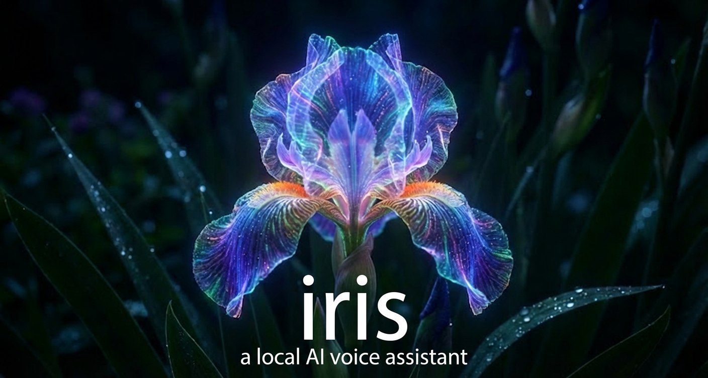

<p align="center">
  
</p>

<h3 align="center">A modular voice and vision assistant for your desktop</h3>

<p align="center">
  Talk with Iris as you would with a person. It looks through the camera or at your screen when a question needs eyes, and every part of it, from speech recognition to the voice, can be swapped.
</p>

<p align="center">
  <a href="LICENSE"></a>
  <a href="#install"></a>
  <a href="#from-source"></a>
</p>

<p align="center">
  <a href="#feature-tour">Feature tour</a> ·
  <a href="#install">Install</a> ·
  <a href="#how-it-works">How it works</a> ·
  <a href="#documentation">Documentation</a>
</p>

## Feature tour

### Talk, or type

<p align="center">
  
</p>

Iris answers as soon as you have finished speaking, not after a fixed silence: a small model hears from your words and intonation whether you are done or only thinking. It starts speaking with the first sentence of its reply. Speak while it talks and it pauses, then stops if you go on, while an echo canceller keeps its own voice out of the microphone. When a question needs it, Iris looks through the camera or at your screen and searches the web, and it reads the images, PDFs and text files you drop into the window.

### Presence: only the orb

<p align="center">
  
</p>

Shrink Iris to its orb, floating above your other windows, and use it by voice alone. The orb shows whether Iris is listening, thinking, looking or speaking, and clicks beside it go to the window underneath.

### Personas, voices and roles

<p align="center">
  
</p>

A persona is who your assistant is: a name, a personality, a voice, and the words that wake it and send it to sleep. Every voice can be played before you pick it and lists the languages it speaks, and you can clone one from a recording. A role, such as Research or Language partner, gives a conversation a focus, and any persona can take on any role.

### Every stage in view

<p align="center">
  
</p>

Settings > Pipeline follows a turn from the microphone to the voice and shows how long each stage took in your latest turn. Click a stage to change it: the recognition model, how the end of your turn is heard, the model server and model, the tools. A setup keeps a set of these choices under a name, so you can switch between setups to compare them.

### Ready in a few steps

<p align="center">
  
</p>

On first launch, a walkthrough finds the language model servers on your computer (Ollama, LM Studio, llama.cpp, vLLM, Jan) and takes any other address you type. The speech models download in the background while you check the microphone, pick a voice and choose the wake word and tools. A short tour of the app follows if you like.

### And also

- **Wake word and sleep word.** Iris can sleep until called by name, and goes back to sleep when told, or once you are clearly done.
- **Threads.** Each thread is a conversation of its own, with its persona, its role and its memory.
- **Memory by topic.** Iris files what was said by topic and brings a topic back when you return to it. **Amnesia** keeps a conversation out of memory.
- **Speech on your computer.** Speech recognition and the voices run locally. The language model runs on Ollama or any server with the OpenAI-compatible API, on this computer or another.

## Install

Iris needs a language model server. The simplest is [Ollama](https://ollama.com/download) on the same computer, with a small model:

```bash
ollama pull qwen3:1.7b
```

### macOS app

For Apple Silicon Macs with macOS 14 or later. Download the disk image from [Releases](https://github.com/clstaudt/iris/releases), drag **Iris** into **Applications**, open it and follow the walkthrough. It downloads the speech models, about 2 GB, while you go on.

### From source

On any platform, with Python 3.11 to 3.13, [uv](https://docs.astral.sh/uv/getting-started/installation/) and Node.js:

```bash
git clone https://github.com/clstaudt/iris.git
cd iris
uv sync
cd ui
npm ci
npm run dev
```

## How it works

Iris is two programs. The Python core (`src/iris`) listens, recognizes speech, talks to the language model, speaks, runs tools and keeps memory. The desktop app (`ui/`, Electron and Svelte) shows it. They talk JSON-RPC over stdio.

| Part | Default |
| --- | --- |
| Speech recognition | Whisper, through MLX on Apple Silicon and faster-whisper elsewhere |
| Turn end | Silero voice activity detection and Smart Turn v3, or a fixed silence |
| Language model | Ollama or any OpenAI-compatible server |
| Voice | Kyutai's Pocket TTS or Kokoro, chosen per persona |
| Echo cancellation | WebRTC's AEC3 |
| Tools | Camera, screen, web search, memory and going to sleep |

Speech recognition and the voice are slots that plugins can fill with other engines, and tools are plugins too. A plugin is a Python module in `~/.iris/plugins`; this one lets Iris tell the time ([full example](examples/plugins/clock.py)):

```python
import time

from iris.plugin import Plugin, Tool


def current_time(**_) -> dict:
    return {"success": True, "result": time.strftime("%A %d %B %Y, %H:%M")}


class Clock(Plugin):
    id = "clock"
    name = "Clock"

    def tools(self, context):
        return [
            Tool(
                name="current_time",
                description="The current local date and time.",
                run=current_time,
                label="Looked at the clock",
            )
        ]


plugin = Clock()
```

## Documentation

- [Getting and using Iris](docs/using-iris.md): installing, the walkthrough, talking, presence, tools, memory, personas and settings
- [Architecture](docs/architecture.md): the core's modules and the RPC protocol
- [Plugins and engines](docs/plugins.md): writing a plugin, model slots
- [Development](docs/development.md): tests, the walkthrough as a new user, end-to-end tests
- [Testing the voice](docs/voice-tests.md): conversations with Iris in a virtual room
- [Building the macOS app](docs/building-the-macos-app.md): packaging, signing and releases

## Acknowledgments

Iris builds on [Whisper](https://github.com/openai/whisper), [MLX Whisper](https://github.com/ml-explore/mlx-examples/tree/main/whisper), [faster-whisper](https://github.com/SYSTRAN/faster-whisper), [Silero VAD](https://github.com/snakers4/silero-vad), [Smart Turn](https://github.com/pipecat-ai/smart-turn), [LiveKit](https://github.com/livekit/python-sdks), [Ollama](https://ollama.com), [Pocket TTS](https://github.com/kyutai-labs/pocket-tts), [Kokoro TTS](https://github.com/nazdridoy/kokoro-tts), [kokoro-onnx](https://github.com/thewh1teagle/kokoro-onnx), [ddgs](https://github.com/deedy5/ddgs), [trafilatura](https://github.com/adbar/trafilatura) and [pypdf](https://github.com/py-pdf/pypdf).

## License

Copyright (C) 2025–2026 Christian Staudt. Iris is free software, licensed under the [GNU Affero General Public License](LICENSE), version 3 or later.
