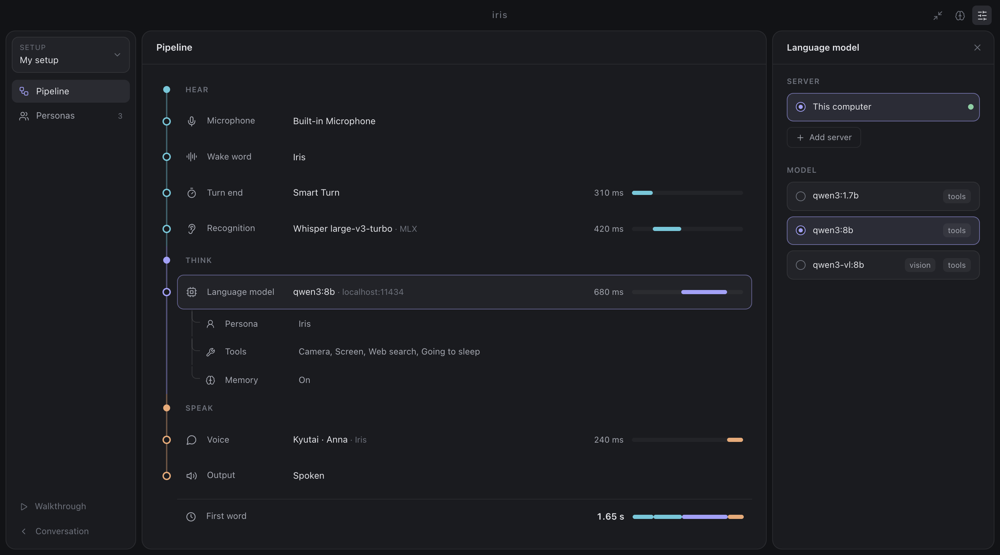
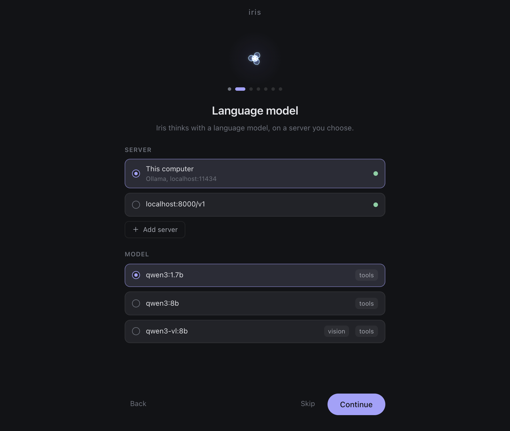

<p align="center">
  
</p>

<h3 align="center">A modular voice and vision assistant for your desktop</h3>

<p align="center">
  Talk with it in your own language. Customize every part, from its voice and personality to the models behind it.
</p>

<p align="center">
  <a href="LICENSE"></a>
  <a href="#install"></a>
  <a href="#from-source"></a>
</p>

<p align="center">
  <a href="#feature-tour">Feature tour</a> ·
  <a href="#install">Install</a> ·
  <a href="#how-it-works">How it works</a> ·
  <a href="#documentation">Documentation</a>
</p>

## Feature tour

### Talk, or type

<p align="center">
  
</p>

Iris answers the moment you finish speaking, and you can interrupt it at any time. It looks through the camera or at your screen, searches the web and reads the files you drop in.

### Personas, voices and roles

<p align="center">
  
</p>

Give your assistant a personality, a voice and a wake word, or clone a voice from a recording. A role such as Research gives a conversation a focus.

### Every stage in view

<p align="center">
  
</p>

Every stage from microphone to voice, with how long it took in your last turn. Click one to swap it.

### Ready in a few steps

<p align="center">
  
</p>

On first launch, a walkthrough finds your model servers and downloads the speech models while you pick a voice.

### And also

- **Wake word:** Iris sleeps until called by name.
- **Presence:** Iris shrinks to its orb, floating above your other windows.
- **Threads:** separate conversations, each with its own persona, role and memory.
- **Memory:** Iris remembers by topic; **Amnesia** keeps a conversation out of it.
- **Local speech:** recognition and voices run on your computer, the language model on Ollama or any OpenAI-compatible server.

## Install

Iris runs on macOS. Linux and Windows are not supported yet: [open an issue](https://github.com/clstaudt/iris/issues/new) to ask for them.

Iris needs a language model server, such as [Ollama](https://ollama.com/download):

```bash
ollama pull qwen3:1.7b
```

### macOS app

For Apple Silicon and macOS 14 or later: download the disk image from [Releases](https://github.com/clstaudt/iris/releases) and drag **Iris** into **Applications**.

### From source

With Python 3.11 to 3.13, [uv](https://docs.astral.sh/uv/getting-started/installation/) and Node.js:

```bash
git clone https://github.com/clstaudt/iris.git
cd iris
uv sync
cd ui
npm ci
npm run dev
```

## How it works

A Python core (`src/iris`) listens, thinks and speaks; an Electron and Svelte app (`ui/`) shows it.

| Part | Default |
| --- | --- |
| Speech recognition | Whisper, through MLX or faster-whisper |
| Turn end | Silero VAD and Smart Turn v3, or a fixed silence |
| Language model | Ollama or any OpenAI-compatible server |
| Voice | Kyutai's Pocket TTS or Kokoro, per persona |
| Echo cancellation | WebRTC's AEC3 |
| Tools | Camera, screen, web search, memory and going to sleep |

Plugins add tools and speech engines: see [Plugins and engines](docs/plugins.md) and a [small example](examples/plugins/clock.py).

## Documentation

- [Using Iris](docs/using-iris.md)
- [Architecture](docs/architecture.md)
- [Plugins and engines](docs/plugins.md)
- [Development](docs/development.md)
- [Testing the voice](docs/voice-tests.md)
- [Building the macOS app](docs/building-the-macos-app.md)

## Acknowledgments

Iris builds on [Whisper](https://github.com/openai/whisper), [MLX Whisper](https://github.com/ml-explore/mlx-examples/tree/main/whisper), [faster-whisper](https://github.com/SYSTRAN/faster-whisper), [Silero VAD](https://github.com/snakers4/silero-vad), [Smart Turn](https://github.com/pipecat-ai/smart-turn), [LiveKit](https://github.com/livekit/python-sdks), [Ollama](https://ollama.com), [Pocket TTS](https://github.com/kyutai-labs/pocket-tts), [Kokoro TTS](https://github.com/nazdridoy/kokoro-tts), [kokoro-onnx](https://github.com/thewh1teagle/kokoro-onnx), [ddgs](https://github.com/deedy5/ddgs), [trafilatura](https://github.com/adbar/trafilatura) and [pypdf](https://github.com/py-pdf/pypdf).

## License

Copyright (C) 2025–2026 Christian Staudt. Iris is free software, licensed under the [GNU Affero General Public License](LICENSE), version 3 or later.

Contributions are welcome, under the [Contributor License Agreement](CLA.md); see [CONTRIBUTING.md](CONTRIBUTING.md).
