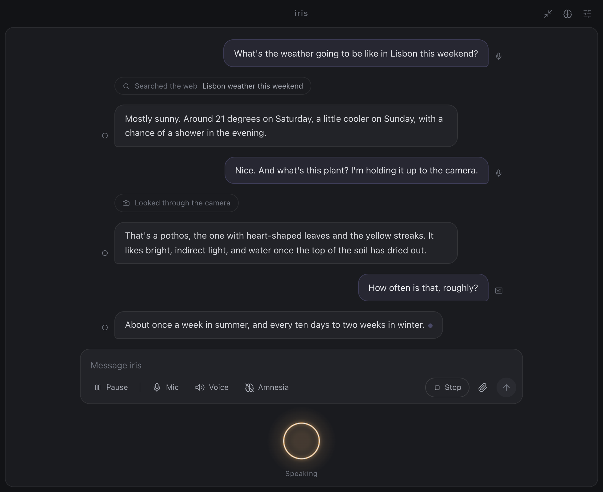
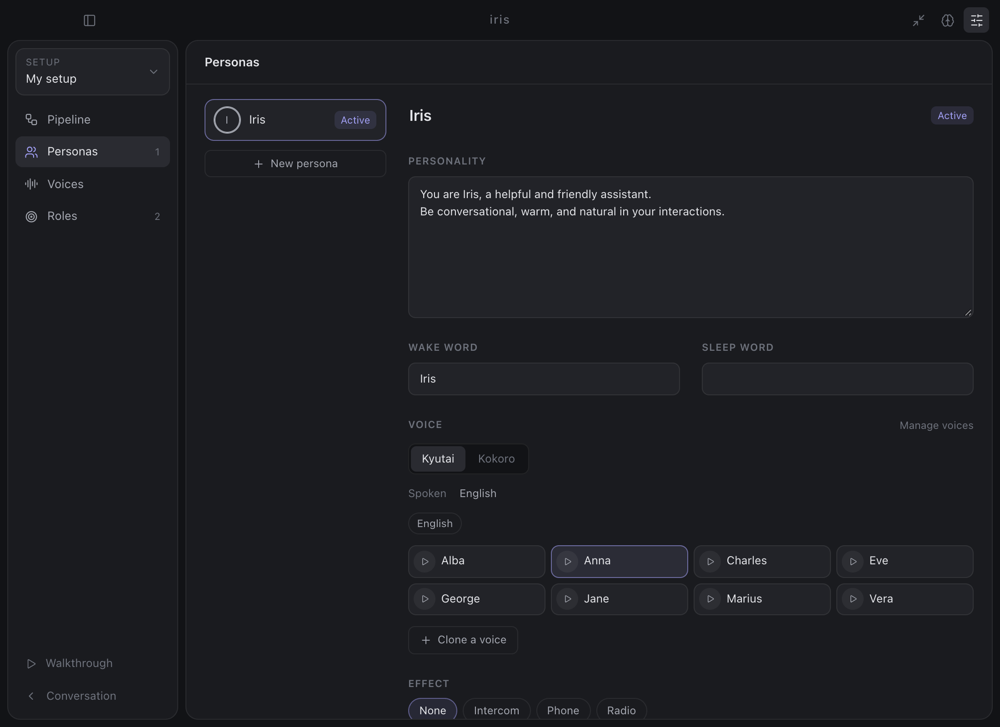

<p align="center">
  
</p>

Iris is a modular voice and vision assistant, used through its desktop app. You talk with it as you would with a person, and it looks through the camera or at your screen when a question needs eyes. Each of its parts, from speech recognition to the voice, can be swapped.

<p align="center">
  
</p>

## What it does

- **Talks with you by voice**, or by text in the same conversation. It answers as soon as you have finished speaking, not after a fixed silence, and starts with the first sentence of its reply.
- **Can be interrupted.** Speak while it talks and it pauses, then stops if you go on. An echo canceller keeps its own voice out of the microphone.
- **Wake word and personas.** Iris can sleep until called by name. Each persona has its own personality, voice (a Kyutai voice can be cloned from a sample), wake word and sleep word.
- **Sees** through the camera and the screen, and reads the images, PDFs and text files you hand it.
- **Searches the web** and reads pages.
- **Remembers** earlier conversations by topic.
- **Runs its speech models on your computer.** The language model comes from Ollama or any server with the OpenAI-compatible API, on this computer or another.
- **Built from swappable parts.** Speech recognition and voices are slots that plugins can fill with other engines, the end of your turn is heard by a model or a silence, and tools are plugins.
- **Presence mode** shrinks Iris to its orb, floating above your other windows.

## Screenshots

Presence: only the orb, floating above other windows. It shows whether Iris is listening, thinking, looking or speaking.


The walkthrough on first launch finds model servers and downloads the speech models while you make the other choices.


Settings > Pipeline: every stage from the microphone to the voice, and how long each took in the latest turn. Click a stage to change it.


The persona editor: personality, wake word, sleep word and voice, with every voice playable.



## Getting started

Iris needs a language model server. The simplest is [Ollama](https://ollama.com/download) on the same computer, with a small model:

```bash
ollama pull qwen3:1.7b
```

### The macOS app

For Apple Silicon Macs with macOS 14 or later:

1. Download the disk image from [Releases](https://github.com/clstaudt/iris/releases), open it and drag **Iris** into **Applications**. Version releases are signed and notarized. The rolling [latest](https://github.com/clstaudt/iris/releases/tag/latest) pre-release holds the newest build of `main`; it is signed ad hoc, so macOS refuses it the first time: click **Open Anyway** in **System Settings > Privacy & Security**.
2. Open Iris and follow the walkthrough. It downloads the speech models (about 2 GB) while you go on.

### From source

On any platform, with Python 3.11 to 3.13, [uv](https://docs.astral.sh/uv/getting-started/installation/), Node.js and a language model server:

```bash
git clone https://github.com/clstaudt/iris.git
cd iris
uv sync
cd ui
npm ci
npm run dev
```

The walkthrough does the rest.

## How it's built

Iris is two programs. The Python core (`src/iris`) listens, recognizes speech, talks to the language model, speaks, runs tools and keeps memory; the desktop app (`ui/`, Electron and Svelte) shows it. They talk over JSON-RPC on stdio. What runs by default:

| Part | Default |
| --- | --- |
| Speech recognition | Whisper, through MLX on Apple Silicon and faster-whisper elsewhere |
| Turn end | Silero voice activity detection and Smart Turn v3, or a fixed silence |
| Language model | Ollama or any OpenAI-compatible server |
| Voice | Kyutai's Pocket TTS or Kokoro, chosen per persona |
| Echo cancellation | WebRTC's AEC3 |
| Tools | Camera, screen, web search, memory and going to sleep, as plugins |

A plugin is a Python module that gives Iris tools, engines or both; [examples/plugins/clock.py](examples/plugins/clock.py) is a small one. More in `docs/`:

- [Getting and using Iris](docs/using-iris.md): installing, the walkthrough, talking, presence, tools, memory, personas and settings
- [Architecture](docs/architecture.md): the core's modules and the RPC protocol
- [Plugins and engines](docs/plugins.md): writing a plugin, model slots
- [Development](docs/development.md): tests, the walkthrough as a new user, end-to-end tests
- [Testing the voice](docs/voice-tests.md): conversations with Iris in a virtual room
- [Building the macOS app](docs/building-the-macos-app.md): packaging, signing and releases

## Acknowledgments

Iris builds on [Whisper](https://github.com/openai/whisper), [MLX Whisper](https://github.com/ml-explore/mlx-examples/tree/main/whisper), [faster-whisper](https://github.com/SYSTRAN/faster-whisper), [Silero VAD](https://github.com/snakers4/silero-vad), [Smart Turn](https://github.com/pipecat-ai/smart-turn), [LiveKit](https://github.com/livekit/python-sdks), [Ollama](https://ollama.com), [Pocket TTS](https://github.com/kyutai-labs/pocket-tts), [Kokoro TTS](https://github.com/nazdridoy/kokoro-tts), [kokoro-onnx](https://github.com/thewh1teagle/kokoro-onnx), [ddgs](https://github.com/deedy5/ddgs), [trafilatura](https://github.com/adbar/trafilatura) and [pypdf](https://github.com/py-pdf/pypdf).

## License

Iris is free software under the GNU General Public License, version 3 or later ([LICENSE](LICENSE)).
